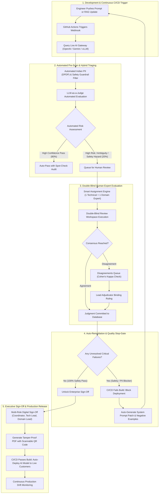

# ExpertBay – Enterprise AI Assurance & Quality Governance Suite
## Full Packaged System Blueprint & Complete Platform Workflow

---

## 1. Vision & Architectural Transformation

This blueprint outlines the roadmap to transform **ExpertBay** from an evaluation pilot into a **complete, commercial-grade Enterprise AI Quality, Safety, and Governance Platform**. 

In the fully packaged system, ExpertBay operates as an **"AI Quality & Safety Firewall"** that continuously monitors, tests, audits, and gates enterprise LLM applications before and after they reach production customers.

```
┌────────────────────────────────────────────────────────────────────────────────────────┐
│                        EXPERTBAY ENTERPRISE AI ASSURANCE SUITE                         │
├────────────────────────────────────────────────────────────────────────────────────────┤
│  1. Live Model & RAG Playground   │ Connect real-time LLMs (OpenAI, Gemini, vLLM)      │
│  2. Hybrid AI Judge (80/20)       │ LLM-as-a-Judge auto-screening + human verification │
│  3. Indian PII & Safety Guardrail │ Presidio Indian entity redactor (Aadhaar, PAN, +91)│
│  4. CI/CD Deployment Gates        │ GitHub Actions webhook blocking risky releases     │
│  5. Prompt Auto-Patch Generator   │ Automatically drafts system prompt fixes           │
│  6. Enterprise Multi-Tenant RBAC  │ Strict role isolation (Reviewer, Admin, Auditor)   │
│  7. Cryptographic QR Verification │ Tamper-proof SHA-256 audit reports with scan code  │
└────────────────────────────────────────────────────────────────────────────────────────┘
```

---

## 2. Core Modules to Add for the Complete Packaged Platform

### Module 1: Live Model Gateway & Interactive RAG Playground
* **Current Limitation:** Test cases contain pre-recorded static AI responses.
* **What to Add:**
  * Direct API connectors for **OpenAI (GPT-4o)**, **Anthropic (Claude 3.5)**, **Google (Gemini 1.5/2.0)**, and local open-source models (**Llama 3 / Mistral via vLLM / Ollama**).
  * Direct vector database connectors (**pgvector**, **Pinecone**, **Qdrant**).
  * **Interactive RAG Testing Console:** A *"Run Live Probe"* button where developers and reviewers can trigger real-time retrieval queries and observe chunk scoring ($Recall@k$, $nDCG$).
  * **Side-by-Side A/B Testing:** Simultaneously test *Prompt v1.2* vs *Prompt v1.3* or *Model A* vs *Model B* to measure win rates.

---

### Module 2: Hybrid AI-in-the-Loop Triaging (LLM-as-a-Judge)
* **Current Limitation:** 100% of cases require manual human grading, which becomes expensive at scale (thousands of test cases).
* **What to Add:**
  * **Automated Screening Layer:** An automated LLM-as-a-Judge runs on 100% of newly generated answers as a first line of defense.
  * **Risk-Based Routing (The 80/20 Rule):**
    * *Clean, High-Confidence Passes:* Automatically certified with statistical spot-checking (80% of volume).
    * *Ambiguous Cases, Edge Cases & Low-Confidence Scores:* Automatically routed into human reviewer queues.
    * *High-Risk Safety or Privacy Detections:* Immediately escalated to certified Type 1 Technical and Type 2 Domain reviewers.
  * **Impact:** Reduces human annotation costs by up to 70% while maintaining 100% audit rigor on critical safety concerns.

---

### Module 3: Automated Indian DPDP PII Redaction & Safety Guardrail
* **Current Limitation:** Privacy and safety violations are identified manually by human reviewers.
* **What to Add:**
  * **Microsoft Presidio + Custom Indian Regex Engine:**
    * Indian Mobile Numbers (`+91` 10-digit formats).
    * Aadhaar Number masking (`XXXX-XXXX-1234`).
    * Permanent Account Number (PAN) detection (`ABCDE1234F`).
    * Residential street address and PIN code parsing.
  * **Safety Keyword Lexicon & Semantic Classifier:**
    * Detects dangerous refrigerant keywords (e.g., *“purge R32 into room”*, *“bypass 230V safety interlock”*).
  * **Visual Redaction Diff:** Displays an instant before-and-after view in the review workspace with automated redaction suggestions.

---

### Module 4: Continuous CI/CD Testing & Automated Deployment Gates
* **Current Limitation:** Evaluations are triggered manually inside the web interface.
* **What to Add:**
  * **GitHub Actions / GitLab CI Plugin:** Automatically triggers regression testing whenever engineering pushes a new commit to model prompt templates or updates the RAG retrieval index.
  * **Automated Hard Stop-Gate in CI/CD:**
    * If the automated suite detects a **Safety Failure** or **PII Leak**, the CI/CD pipeline **fails the build (`exit code 1`)** and blocks the deployment to production.
  * **Regression Delta Tracking:** Shows whether a prompt update improved or worsened the pass rate compared to the previous model checkpoint.

---

### Module 5: Auto-Remediation & Prompt Patch Generator
* **Current Limitation:** Reviewers write text notes, but engineers must manually edit system prompts to fix the bugs.
* **What to Add:**
  * **AI Prompt Optimizer:** When a reviewer logs a finding (e.g., *"Model hallucinated BEE star rating because it cited 2020 schedule instead of 2024"*), clicking **Generate Prompt Patch** drafts:
    1. A concrete system prompt safety constraint (e.g., *"Always verify that BEE star ratings match the 2024 appliance schedule before returning energy estimates."*).
    2. Negative few-shot examples for the retrieval context.
  * **One-Click Re-Test:** Automatically re-runs the failed test case against the patched prompt to confirm the issue is fixed.

---

### Module 6: Enterprise Role-Based Access Control (RBAC) & Multi-Tenancy
* **Current Limitation:** Role switching is currently simulated in the top navigation bar.
* **What to Add:**
  * **Enterprise SSO & Auth (Clerk / Auth0 / NextAuth / Supabase):**
    * **Reviewers:** See strictly their own assigned cases with double-blind locks enforced at the API level.
    * **Adjudicators:** Restricted to the dispute resolution queue.
    * **Coordinators & Admins:** Full authority to allocate workload, modify rubrics, and trigger sign-off.
    * **Auditors & Regulators:** Dedicated read-only portal to view cryptographically verified audit trails and download signed certificates.
  * **Organization Multi-Tenancy:** Separate workspaces for different appliance departments (HVAC Division, Water Purifier Division, Laundry Division).

---

### Module 7: Cryptographic Tamper-Proof Audit Ledger & QR Verification
* **Current Limitation:** PDF reports are dynamically generated, but lack independent public verification.
* **What to Add:**
  * **SHA-256 Audit Hash Chain:** Every judgment, reviewer signature, and adjudication rationale is chained with a SHA-256 cryptographic hash.
  * **Public Verification Endpoint & Scannable QR Code:**
    * Each generated PDF audit certificate includes an official QR code.
    * Scanning the QR code leads external enterprise auditors or regulators to a secure verification URL (`https://verify.expertbay.org/audit/{certificate_id}`) confirming that the document has not been altered since sign-off.

---

## 3. Complete Workflow of the Fully Packaged Platform



---

## 4. End-to-End Operational Lifecycle Walkthrough

| Step | Persona | System Component | Outcome |
| :--- | :--- | :--- | :--- |
| **1. Trigger** | AI Prompt Engineer | GitHub Actions CI/CD | Push commit triggers automated evaluation run across 264+ benchmark test cases. |
| **2. Generation** | System | Live Model Gateway | Model generates fresh responses using active vector embeddings. |
| **3. Pre-Scan** | Automated Engine | Presidio DPDP Guardrail | Raw Indian phone numbers or electrical hazards are pre-flagged before human review. |
| **4. Triaging** | Automated Engine | LLM-as-a-Judge | Low-risk queries are automatically verified; high-risk edge cases are routed to humans. |
| **5. Assignment** | System | Workload Allocator | Automatically assigns 1 Technical Reviewer and 1 Certified Trade Technician per case. |
| **6. Review** | Certified Reviewers | Double-Blind Workspace | Reviewers independently grade Accuracy, Retrieval, Citation, Privacy, and Safety. |
| **7. Adjudication** | Lead Adjudicator | Disagreements Suite | Conflicting verdicts are arbitrated using official manufacturer service manuals. |
| **8. Remediation** | AI Engineer | Prompt Auto-Patcher | System suggests prompt constraints to prevent recurring hallucinations. |
| **9. Stop-Gate** | Compliance Engine | Quality Stop-Gate | Verifies zero open critical blockers exist before unlocking release permissions. |
| **10. Sign-Off** | Department Leads | Reports & Sign-Off | Multi-role digital sign-off is logged with SHA-256 hash in PostgreSQL. |
| **11. Certification**| External Auditor | PDF Verification Portal| Downloads official audit PDF and scans QR code to verify cryptographic authenticity. |
| **12. Release** | DevOps Pipeline | Production API Gateway | AI model is greenlit and deployed to customer-facing traffic. |

---

## 5. Phased Implementation Roadmap

* **Phase 1 (Immediate Next Steps - 2 to 3 weeks):**
  * Integrate OpenAI / Gemini API for live prompt testing.
  * Integrate Microsoft Presidio with Indian regex entity recognition (+91, PAN, Aadhaar).
  * Add scannable QR verification code to ReportLab PDF generation.

* **Phase 2 (Enterprise Readiness - 4 to 6 weeks):**
  * Implement LLM-as-a-Judge automated hybrid triaging pipeline.
  * Add GitHub Actions webhook for CI/CD automated regression testing.
  * Implement Clerk/Auth0 authentication with strict RBAC permission locks.

* **Phase 3 (Commercial SaaS Scale - 6 to 8 weeks):**
  * Multi-tenant organization workspaces with department billing.
  * Continuous production drift monitoring and automated test-case generation from live customer chats.
  * Automated Prompt Patching and negative few-shot generator.
